# Zoológico - Checkpoint 2

## Integrantes

| Nome completo | RM |
|---|---|
| Gustavo de Jesus | RM567926 |
| Gustavo Siciliano | RM568419 |
| Samuel Keniti | RM567614 |
| Manuel Pedro | RM567458 |
| Vinicius Morrone | RM566884 |

**Professor:** Dr. Marcel Stefan Wagner

---

## Sobre o projeto

Sistema web para **gerenciar os animais de um zoológico**. Pelo navegador é possível **cadastrar, listar, pesquisar por nome, ver detalhes, editar e excluir** animais, informando espécie, habitat, peso, dieta e data de chegada.

O site funciona em computador e celular (veja a seção [Responsividade](#responsividade)).

## Tecnologias e dependências

| Item | Detalhe |
|---|---|
| Linguagem / Framework | C# e .NET 8, ASP.NET Core MVC |
| IDE | Visual Studio 2022/2026 |
| Banco de dados | Nenhum. Os dados ficam em memória (lista dentro do `AnimalRepository`) |
| Pacotes NuGet extras | Nenhum (só o que vem no template MVC) |
| Ícones | [Lucide](https://lucide.dev) (licença ISC), em arquivos SVG na pasta `wwwroot/icons`. Funcionam sem internet |
| Favicon | Pata de animal (`wwwroot/favicon.svg` e `wwwroot/favicon.ico`) |

**Padrões usados:** MVC, Repository (`AnimalRepository`) e injeção de dependência (o repositório é registrado como *Singleton* no `Program.cs` e recebido pelo Controller no construtor).

## Como executar

1. Abrir o arquivo `ZooApp.slnx` no Visual Studio.
2. Apertar **F5**.
3. O navegador abre em `/Animais/Listar`.

> Como não há banco de dados, ao reiniciar o site voltam apenas os 3 animais de exemplo (Simba, Madalena e Pingo).

## Estrutura do projeto

```
ZooApp
├── Controllers     AnimaisController.cs
├── Models          Animal.cs, Habitat.cs
├── Repositories    AnimalRepository.cs
├── TagHelpers      DietaTagHelper.cs, AlertaTagHelper.cs
├── Views
│   ├── Shared      _Layout.cshtml (cabeçalho, rodapé e modal)
│   └── Animais     Listar, Detalhes, Cadastrar, Editar
├── wwwroot
│   ├── css         site.css
│   ├── js          site.js (modais de confirmação)
│   └── icons       ícones SVG
└── Program.cs
```

## Diagrama de classes

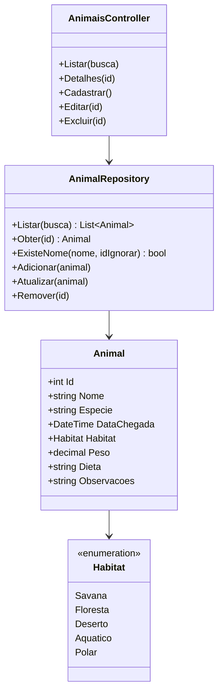

## Modelo `Animal`

| Propriedade | Tipo | Regra |
|---|---|---|
| `Id` | `int` | Gerado automaticamente |
| `Nome` | `string` | Obrigatório e único |
| `Especie` | `string` | Obrigatória |
| `DataChegada` | `DateTime` | Campo de data. Não pode ser no futuro |
| `Habitat` | `enum` | Savana, Floresta, Deserto, Aquático ou Polar |
| `Peso` | `decimal` | Entre 0,1 e 10000 kg |
| `Dieta` | `string` | Escolhida em dropdown (Carnívoro, Herbívoro ou Onívoro). As opções vêm do Controller pelo `ViewBag` |
| `Observacoes` | `string?` | Opcional |

## Validações

- **No Model (DataAnnotations):** `[Required]`, `[Range]`, `[Display]`, `[DataType]` e `[DisplayFormat]`.
- **No Controller (método `ValidarRegras`):**
  - a data de chegada não pode ser posterior a hoje;
  - não pode existir outro animal com o mesmo nome (ignora maiúsculas e minúsculas e, na edição, ignora o próprio animal). A checagem usa o método `ExisteNome` do Repository.

As mensagens de erro aparecem embaixo de cada campo (`ModelState.AddModelError`).

## Endpoints

| Método | Rota | Função |
|---|---|---|
| GET | `/Animais/Listar` | Lista os animais |
| GET | `/Animais/Listar?busca=simba` | Pesquisa por nome |
| GET | `/Animais/Detalhes/{id}` | Mostra um animal |
| GET | `/Animais/Cadastrar` | Formulário de cadastro |
| POST | `/Animais/Cadastrar` | Salva o novo animal |
| GET | `/Animais/Editar/{id}` | Formulário de edição |
| POST | `/Animais/Editar` | Salva a edição |
| POST | `/Animais/Excluir/{id}` | Exclui o animal (após confirmar no modal) |

## Tag helpers

| Tag helper | Uso | O que faz |
|---|---|---|
| `DietaTagHelper` | `<dieta valor="Carnívoro"></dieta>` | Mostra a dieta numa etiqueta colorida: vermelho (carnívoro), verde (herbívoro) ou laranja (onívoro) |
| `AlertaTagHelper` | `<alerta mensagem="..."></alerta>` | Mostra a mensagem de sucesso depois de cadastrar, editar ou excluir. Se a mensagem estiver vazia, não mostra nada |

Eles são ativados no arquivo `Views/_ViewImports.cshtml` pela linha `@addTagHelper *, ZooApp`.

## Modal de confirmação

Existe **um único modal** (`<dialog>`) no `_Layout.cshtml`, controlado pelo `wwwroot/js/site.js`. Ele é usado em três situações:

| Situação | Como funciona |
|---|---|
| Cadastrar | Ao clicar em Salvar, o JavaScript segura o envio e abre "Confirmar cadastro". Só envia se o usuário confirmar |
| Editar | Mesmo mecanismo, com "Confirmar edição" |
| Excluir | O botão Excluir abre "Confirmar exclusão" mostrando o nome do animal. Ao confirmar, um formulário escondido envia o POST para `/Animais/Excluir/{id}` |

Se o usuário clicar em Cancelar, o modal fecha e nada é alterado.

## Layout

O arquivo `Views/Shared/_Layout.cshtml` é a moldura de todas as telas: cabeçalho com ícone e menu, área de conteúdo (`@RenderBody()`), rodapé e o modal. Todo o estilo está em `wwwroot/css/site.css`.

## Responsividade

O site se adapta a diferentes tamanhos de tela com CSS (sem nenhuma biblioteca), usando dois pontos de quebra:

| Tela | O que muda |
|---|---|
| Até 768px (tablet e celular) | Cabeçalho vira coluna, título e espaçamentos ficam menores |
| Até 480px (celular) | Campo de busca, Buscar e Limpar ocupam a largura da tela, com o botão "Novo animal" abaixo. A tabela de detalhes fica mais compacta e o modal abre um pouco mais abaixo para não cobrir o título |
| Qualquer tamanho | A tabela de animais ganha **rolagem lateral** se não couber, e os botões nunca esticam a largura toda |

---

## Telas

### 1. Listar animais (`/Animais/Listar`)
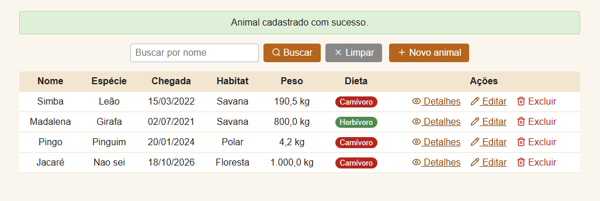

Tabela com todos os animais. Em cada linha há as ações **Detalhes**, **Editar** e **Excluir**. Acima ficam o campo de pesquisa, os botões **Buscar** e **Limpar** e o botão **Novo animal**. A dieta aparece com o tag helper `<dieta>`, e a mensagem de sucesso no topo aparece pelo tag helper `<alerta>`.

### 2. Pesquisa por nome (`/Animais/Listar?busca=simba`)
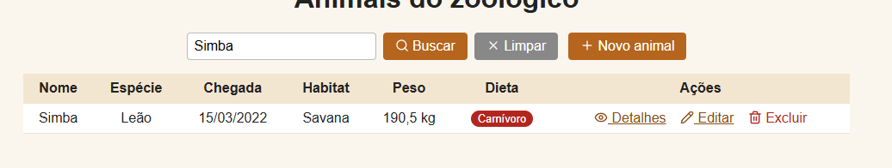

O texto digitado vai na URL como `busca`. O Controller chama `repo.Listar(busca)`, que devolve só os animais cujo nome contém o texto, sem diferenciar maiúsculas de minúsculas. O botão **Limpar** volta para a lista completa.

### 3. Cadastrar animal (`/Animais/Cadastrar`)
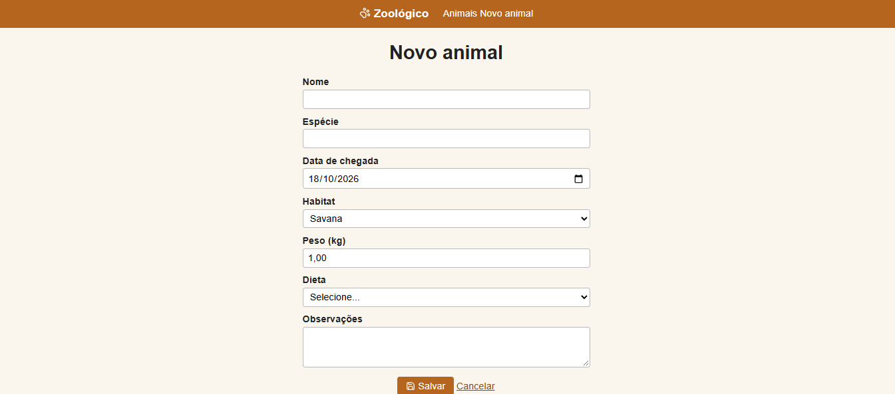

Formulário com texto (nome e espécie), data (chegada), dropdown do enum (habitat), número (peso), dropdown de dieta (opções vindas do Controller) e observações.

### 4. Confirmação do cadastro
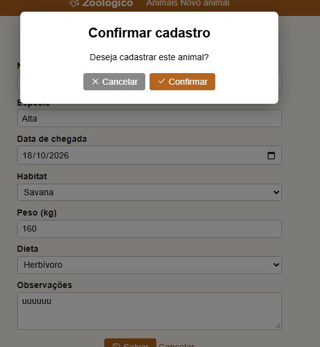

Ao clicar em Salvar, o modal pede a confirmação antes de enviar.

### 5. Validação
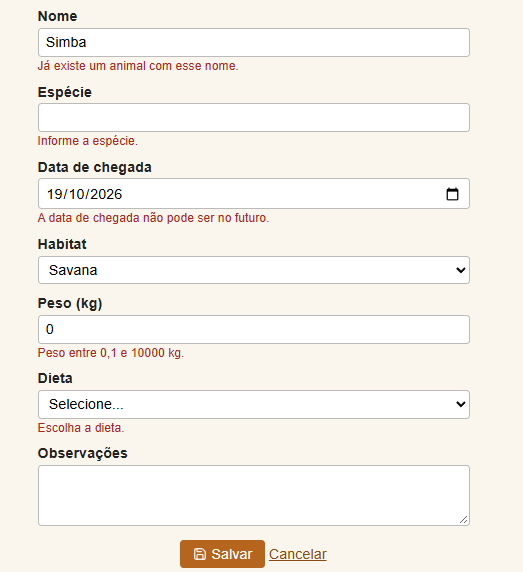

Mostra os erros embaixo de cada campo: campo vazio, peso inválido, data no futuro e nome repetido.

### 6. Detalhes (`/Animais/Detalhes/{id}`)
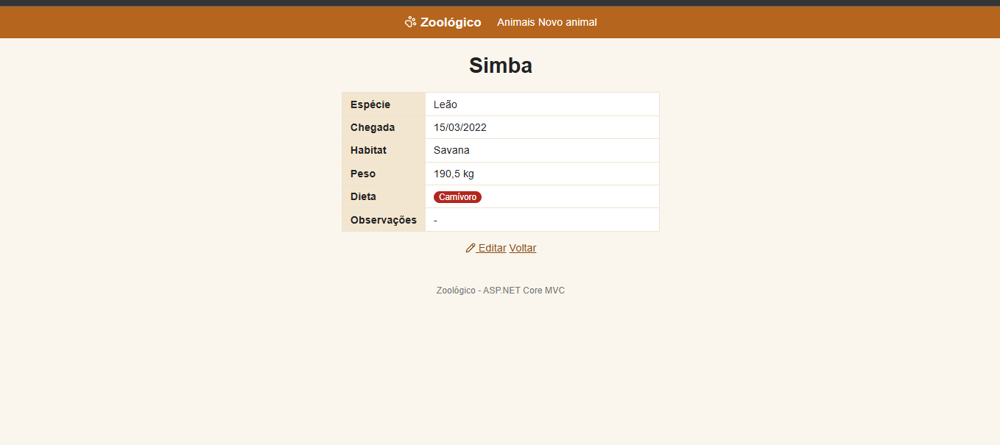

Mostra todos os dados do animal em formato de tabela (campo e valor).

### 7. Editar animal (`/Animais/Editar/{id}`)
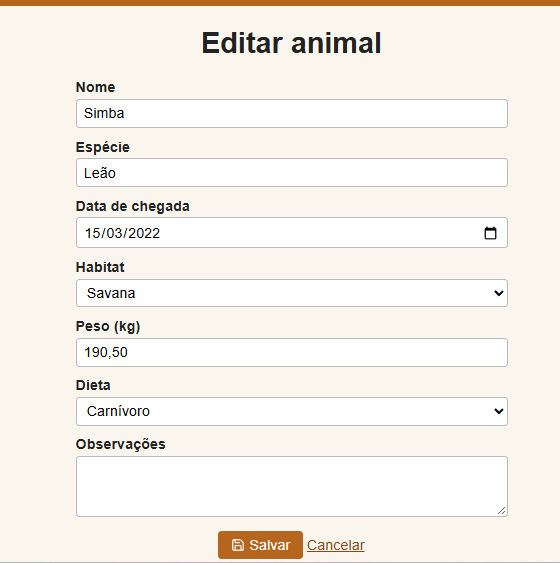

Mesmo formulário do cadastro, já preenchido. O `Id` vai em um campo escondido para o sistema saber qual animal atualizar.

### 8. Confirmação da edição
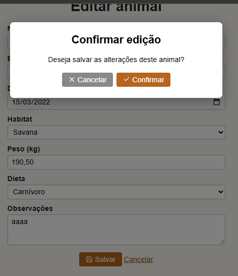

Ao salvar a edição, o modal pergunta se deseja salvar as alterações.

### 9. Confirmação da exclusão
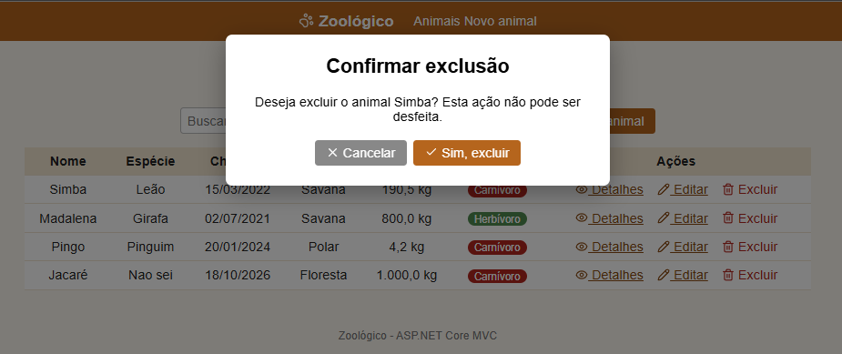

O modal mostra o nome do animal e só remove depois do clique em "Sim, excluir".

### 10. Versão para celular
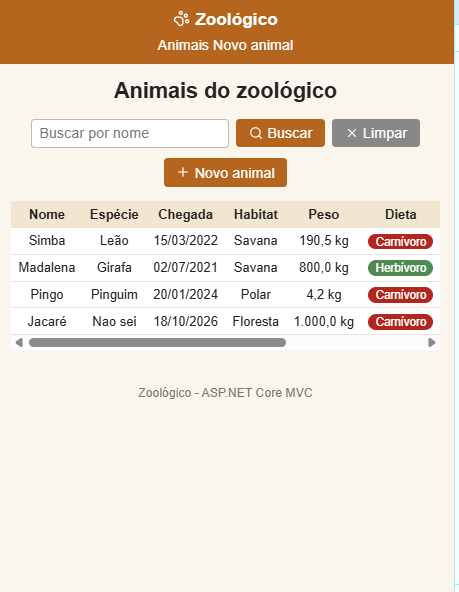

A mesma tela de listagem em tamanho de celular, mostrando a responsividade descrita acima.

---

## Testes realizados (manuais, pelo navegador)

| Teste | Resultado esperado |
|---|---|
| Abrir o site | Lista com 3 animais |
| Cadastrar animal válido e confirmar no modal | Aparece na lista com mensagem de sucesso |
| Cadastrar e cancelar no modal | Nada é salvo |
| Cadastrar com campos vazios | Mensagens de erro, nada é salvo |
| Cadastrar com data futura | Erro "A data de chegada não pode ser no futuro." |
| Cadastrar com nome já existente | Erro "Já existe um animal com esse nome." |
| Pesquisar "simba" | Mostra só o Simba |
| Pesquisar texto inexistente | "Nenhum animal encontrado." |
| Clicar em Limpar | Volta a lista completa |
| Ver detalhes de um animal | Tabela com todos os dados |
| Editar e confirmar no modal | Dados atualizados na lista |
| Editar mantendo o mesmo nome | Salva normalmente (não conta como nome repetido) |
| Excluir e cancelar no modal | Animal continua na lista |
| Excluir e confirmar | Animal removido |
| Abrir em tela de celular | Layout se ajusta e o modal não cobre o título |

## Requisitos do checkpoint

| Requisito | Onde está |
|---|---|
| CRUD completo no navegador | `AnimaisController` e views em `Views/Animais` |
| Pesquisa por propriedade do modelo | Busca por `Nome` |
| Sem banco de dados | Lista em memória no `AnimalRepository` |
| Diferentes tipos de dados | `DateTime`, `enum`, `decimal`, `string` e dropdown vindo do Controller |
| Tag helpers criados e usados | `DietaTagHelper` e `AlertaTagHelper` |
| Layout da aplicação | `_Layout.cshtml` e `site.css` |
| Confirmação de remoção | Modal de exclusão |